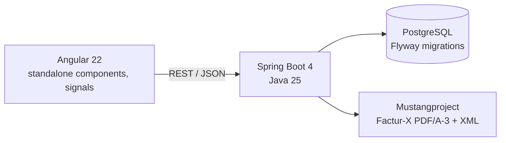

# eFacture PME

**Factur-X e-invoicing for French small businesses, built with Spring Boot 4 (Java 25) and Angular 22.**

France is making electronic invoicing mandatory between VAT-registered businesses. Every company must be able to **receive** e-invoices since **1 September 2026**, and small and medium businesses must **issue** them from **1 September 2027**. Invoices travel through government-registered platforms (*plateformes agréées*) in structured formats such as **Factur-X**: a readable PDF with machine-readable XML embedded inside.

eFacture PME lets a small business create compliant invoices and credit notes, enforces the legal rules a spreadsheet cannot, and produces Factur-X files that pass the official EN 16931 validation.

> **Demo project.** No invoice is sent to any tax authority or platform. Connecting to a real *plateforme agréée* requires registration; the upcoming platform integration is simulated.

## Features

- **Seller profile and customers**, with SIREN (Luhn checksum) and French VAT number (key) validation
- **Invoice lifecycle**: draft, issue, credit note. An issued invoice can no longer be edited or deleted; corrections go through a credit note that references it
- **Gapless numbering** per document type and year: `F-2026-00001`, `AV-2026-00001`, with no gap or duplicate even under concurrent issuance
- **Mandatory mentions** checked before issuance; every missing item is reported at once (`422` with the list)
- **Amounts** in `BigDecimal`, VAT computed per rate on the rate total, as EN 16931 requires
- **Factur-X export**: PDF/A-3 with embedded CII XML, EN 16931 profile, validated with the Mustang validator
- **Angular UI**: invoices, customers, seller profile, live totals preview, French number and date formats

## Architecture



| Layer | Stack |
|---|---|
| Backend | Java 25, Spring Boot 4.1, Spring Data JPA, Bean Validation, Flyway |
| Database | PostgreSQL 17 |
| Factur-X | Mustangproject 2.26 (generation and validation) |
| Frontend | Angular 22, TypeScript, reactive forms, signals |
| Tests | JUnit 5, Mockito, Testcontainers, MockMvc, Vitest |

The backend is organised by feature (`company`, `customer`, `invoice`, `facturx`), each with its entity, repository, service, controller and DTO records.

## Technical decisions

**Gapless numbering without a gap on failure.** French law requires a continuous, chronological sequence. The number is assigned at issuance, never at draft creation, by a single atomic upsert:

```sql
INSERT INTO invoice_sequence (type, year, last_value) VALUES (:type, :year, 1)
ON CONFLICT (type, year) DO UPDATE SET last_value = invoice_sequence.last_value + 1
RETURNING last_value
```

It runs inside the issuing transaction: concurrent issuances queue on the row lock, and if the issuance fails, the increment rolls back with it. A test issues 20 invoices in parallel and checks they receive exactly numbers 1 to 20.

**Business rules live in the entity.** `Invoice` exposes `draft()`, `issue()`, `creditNoteFor()` and `updateDraft()` instead of setters, so an issued invoice cannot be modified whatever code calls it. A database `CHECK` constraint backs it up: a draft never has a number, an issued document always has one.

**Optimistic locking.** `@Version` on `Invoice` prevents two concurrent edits or issuances of the same draft from both succeeding; the loser gets a `409`.

**VAT per rate, not per line.** EN 16931 computes VAT once per rate on the sum of that rate's lines. Rounding line by line gives different totals (three lines of 0.10 at 5.5 %: 0.03 line by line, 0.02 on the total), and a Factur-X validator would reject the mismatch.

**Factur-X is rebuilt on each download** from the frozen invoice, so the file can never drift from the data.

**Errors follow RFC 9457** (`ProblemDetail`), with the list of missing mentions or invalid fields, which the UI displays as is.

## Tests

| Suite | Count | What it covers |
|---|---|---|
| Backend unit (JUnit 5, Mockito) | 34 | SIREN and VAT keys, totals and rounding, invoice rules, mandatory mentions, service behaviour |
| Factur-X | 5 | Generated files pass the Mustang validator (PDF/A-3 and EN 16931 rules); embedded XML carries the same totals |
| Backend integration (Testcontainers) | 4 | Full API lifecycle on a real PostgreSQL, refused issuance consumes no number, 20 concurrent issuances |
| Frontend (Vitest) | 4 | Navigation, totals preview matching the backend figures |

Testcontainers caught a real schema mismatch (`CHAR` columns against `String` fields) that unit tests could not see.

## Run locally

Requirements: Java 25, Maven, Node.js 24, Docker.

```bash
# 1. Database (PostgreSQL on port 5433)
docker compose up -d

# 2. Backend on http://localhost:8080
cd backend
mvn spring-boot:run

# 3. Frontend on http://localhost:4200 (proxies /api to the backend)
cd frontend
npm install
npx ng serve
```

Then open http://localhost:4200, fill in **Mon entreprise**, add a customer and create an invoice.

Run the tests:

```bash
cd backend && mvn test        # needs Docker for the Testcontainers suite
cd frontend && npx ng test --watch=false
```

## API

| Method | Path | Description |
|---|---|---|
| `GET` `PUT` | `/api/company` | Seller profile |
| `GET` `POST` | `/api/customers` | List, create customers |
| `GET` `PUT` | `/api/customers/{id}` | Read, update a customer |
| `GET` | `/api/invoices?status=` | List invoices, optionally by status |
| `POST` | `/api/invoices` | Create a draft |
| `GET` `PUT` `DELETE` | `/api/invoices/{id}` | Read, edit or delete a draft |
| `POST` | `/api/invoices/{id}/issue` | Issue: assigns the number, freezes the invoice |
| `POST` | `/api/invoices/{id}/credit-note` | Create a credit note cancelling an issued invoice |
| `GET` | `/api/invoices/{id}/facturx` | Download the Factur-X PDF |

## Roadmap

- **Simulated registered platform**: submission, statuses (submitted, rejected, accepted, paid) with simulated rejections
- **Spring Security with JWT**, manager and accountant roles
- **Kafka** events on status changes
- **Supplier invoices**: import a Factur-X file and read its XML
- Docker images, GitHub Actions CI, online demo

## Limitations

- One instance serves a single issuing company.
- The PDF is Mustang's standard rendering of the invoice data, not a branded layout.
- The buyer's electronic invoicing address, used by the reform to route invoices between platforms, is not handled yet.

The full specification (in French) is in [docs/CAHIER_DES_CHARGES.md](docs/CAHIER_DES_CHARGES.md).
