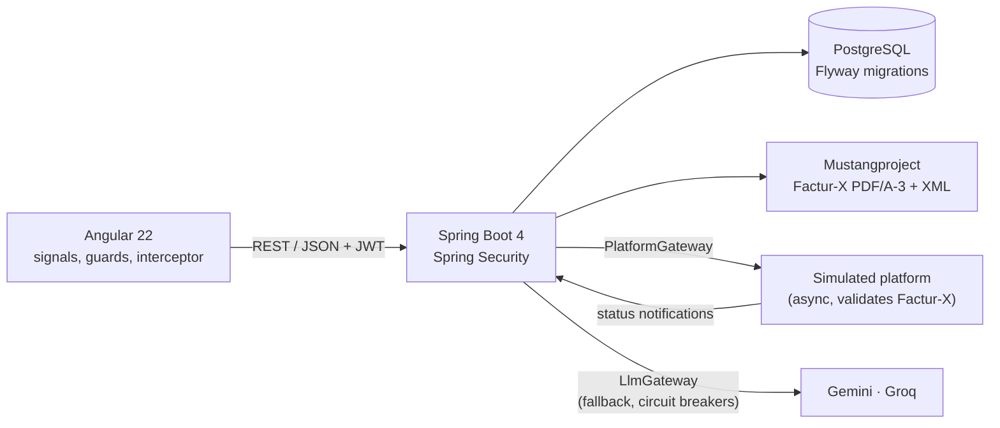

# eFacture PME

[](https://github.com/MamitianaRak/efacture/actions/workflows/ci.yml)

**Factur-X e-invoicing for French small businesses, built with Spring Boot 4 (Java 25) and Angular 22.**

France is making electronic invoicing mandatory between VAT-registered businesses. Every company must be able to **receive** e-invoices since **1 September 2026**, and small and medium businesses must **issue** them from **1 September 2027**. Invoices travel through government-registered platforms (*plateformes agréées*) in structured formats such as **Factur-X**: a readable PDF with machine-readable XML embedded inside.

eFacture PME lets a small business create compliant invoices and credit notes, enforces the legal rules a spreadsheet cannot, produces Factur-X files that pass the official EN 16931 validation, and follows each invoice on the platform until it is paid. On the receiving side, it reads supplier invoices with **generative AI in Java (Spring AI)**, and checks every value the model returns before anyone can validate it.

> **Demo project.** No invoice is sent to any tax authority or real platform. Connecting to a real *plateforme agréée* requires registration, so the platform is **simulated** behind an interface a real client could implement.

## Features

- **Seller profile and customers**, with SIREN (Luhn checksum) and French VAT number (key) validation
- **Invoice lifecycle**: draft, issue, credit note. An issued invoice can no longer be edited or deleted; corrections go through a credit note that references it
- **Gapless numbering** per document type and year: `F-2026-00001`, `AV-2026-00001`, with no gap or duplicate even under concurrent issuance
- **Mandatory mentions** checked before issuance; every missing item is reported at once (`422` with the list)
- **Amounts** in `BigDecimal`, VAT computed per rate on the rate total, as EN 16931 requires
- **Factur-X export**: PDF/A-3 with embedded CII XML, EN 16931 profile, validated with the Mustang validator
- **Simulated registered platform**: submission, then the lifecycle statuses of the reform (deposited, rejected, delivered, approved, refused, paid) with realistic rejection and refusal reasons
- **Roles with JWT authentication**: the manager runs everything; the accountant reads, follows payments and handles credit notes
- **Dashboard**: yearly revenue, collected, receivable and overdue amounts, monthly chart, invoices needing action
- **Supplier invoices read by AI**: a Factur-X file is read from its XML, with no model; a plain PDF, a scan or a photo is read by an LLM into a typed Java record, then checked by deterministic rules (identifier checksums, totals, duplicates, and whether each identifier really appears in the document) before a person validates it
- **LLM gateway** over Groq and Gemini: lanes per task, automatic fallback between providers, a circuit breaker per model, metrics
- **Angular UI** with live totals preview, live platform status timeline, side-by-side review of supplier invoices (original document next to the fields read), French number and date formats

## Architecture



| Layer | Stack |
|---|---|
| Backend | Java 25, Spring Boot 4.1, Spring Data JPA / Hibernate, Bean Validation, Flyway |
| Security | Spring Security 7, OAuth2 resource server, HS256 JWT, bcrypt, method security |
| Database | PostgreSQL 17 |
| Factur-X | Mustangproject 2.26 (generation, reading and validation) |
| Generative AI | Spring AI 2.0 (structured output, multimodal), Gemini and Groq through their OpenAI-compatible APIs, Resilience4J, PDFBox |
| Frontend | Angular 22, TypeScript, reactive forms, signals |
| Tests | JUnit 5, Mockito, Testcontainers, MockMvc, Spring Security Test, Vitest |

The backend is organised by feature (`company`, `customer`, `invoice`, `facturx`, `platform`, `dashboard`, `security`, `ai`, `supplier`), each with its entity, repository, service, controller and DTO records. Flyway owns the schema; Hibernate maps the entities and validates them against it at startup.

## Technical decisions

**Gapless numbering without a gap on failure.** French law requires a continuous, chronological sequence. The number is assigned at issuance, never at draft creation, by a single atomic upsert:

```sql
INSERT INTO invoice_sequence (type, year, last_value) VALUES (:type, :year, 1)
ON CONFLICT (type, year) DO UPDATE SET last_value = invoice_sequence.last_value + 1
RETURNING last_value
```

It runs inside the issuing transaction: concurrent issuances queue on the row lock, and if the issuance fails, the increment rolls back with it. A test issues 20 invoices in parallel and checks they receive exactly numbers 1 to 20.

**Business rules live in the entity.** `Invoice` exposes `draft()`, `issue()`, `creditNoteFor()` and `updateDraft()` instead of setters, so an issued invoice cannot be modified whatever code calls it. A database `CHECK` constraint backs it up: a draft never has a number, an issued document always has one.

**Optimistic locking.** `@Version` on `Invoice` prevents two concurrent edits or issuances of the same draft from both succeeding; the loser gets a `409`.

**VAT per rate, not per line.** EN 16931 computes VAT once per rate on the sum of that rate's lines. Rounding line by line gives different totals (three lines of 0.10 at 5.5 %: 0.03 line by line, 0.02 on the total), and a Factur-X validator would reject the mismatch.

**Factur-X is rebuilt on each download** from the frozen invoice, so the file can never drift from the data.

**The platform behind a port.** The application only knows the `PlatformGateway` interface. The simulator implements it like a real platform would behave: it works asynchronously, really validates each Factur-X file, rejects or refuses at configurable rates, and sends status notifications back as events.

**A state machine for the lifecycle.** `PlatformStatus` lists the allowed transitions; `Submission.apply()` refuses impossible ones (a buyer cannot approve an invoice that was never delivered) and ignores a status received twice, since platforms may deliver the same notification more than once. Every change is kept in a history.

**One live submission per invoice, enforced by the database.** A partial unique index (`WHERE status <> 'REJETEE'`) guarantees it even when two clicks arrive at the same time; a new submission is only possible after a technical rejection.

**Authorization next to the business rule.** Rules sit on the controllers with `@PreAuthorize`, including a business-aware one: `hasRole('MANAGER') or @invoiceAccess.isCreditNote(#id)` lets the accountant issue credit notes but not invoices. Login returns the same `401` for an unknown email and a wrong password, so it does not reveal which accounts exist.

**Dashboard in SQL.** Figures are aggregated in PostgreSQL with CTEs (`DISTINCT ON` for each invoice's latest platform status, credited invoices, receivables) rather than by loading entities. An invoice is receivable when it is issued, not cancelled by a credit note, and neither paid nor refused.

**Errors follow RFC 9457** (`ProblemDetail`), with the list of missing mentions or invalid fields, which the UI displays as is.

**One clock for the whole application.** Invoice dates, token issuance and token expiry all use the injected `Clock`. A test run that crossed midnight exposed two places that did not: tests reading the real date, and Spring Security checking JWT expiry against the system clock.

## Generative AI: reading supplier invoices

**The model reads, the code decides.** An LLM turns a document into an `ExtractedInvoice` record (structured output). Nothing it returns is trusted as is: deterministic checks run on the result, and any error blocks validation until a person fixes it.

| Check | What it catches |
|---|---|
| SIREN Luhn key, VAT key, IBAN mod 97 | A digit misread |
| Net + VAT = gross, sum of lines = net | Totals misread, or an inconsistent document |
| **Grounding**: each identifier must appear in the PDF's text layer | A value the model **invented**. On a real invoice that had no IBAN, the model returned one; checksums alone would miss an invented value that happens to be valid |
| Same supplier and number already received | Duplicates |
| Payment means (EN 16931 BT-81) | A missing IBAN only matters for a transfer, not for a direct debit or a paid invoice |

A value **typed by a person** and absent from the document (an IBAN given by phone, say) is a warning asking to check it with the supplier through a known channel: the standard defence against bank-detail fraud.

**Documents as images plus text.** PDF pages are rendered to images, which every vision model accepts (Gemini's OpenAI-compatible API rejects file parts), and the PDF's text layer is sent alongside so figures are copied rather than recognised from pixels. If no document model answers, a text model takes over from the text layer; if none answers at all, the file is kept for manual entry.

**Prompt injection.** An invoice comes from a third party. The prompt tells the model that instructions found in a document are data, never orders; the evaluation set contains such an attempt.

**LLM gateway.** `LlmGateway` gives each task a lane (fast, reasoning, document) with an ordered list of provider and model candidates. A failing candidate (quota, outage, timeout) hands over to the next; a Resilience4J circuit breaker per model stops calling one that keeps failing. Circuits are per model, not per provider, because quotas are: Gemini's free tier allows `gemini-3.5-flash` 20 requests a day while `gemini-3.5-flash-lite` has its own quota. Every answer records which provider and model produced it.

### Evaluation

`ExtractionEvaluation` reads a set of 20 **fictitious** supplier invoices with the real models and compares each field with the expected value. The invoices are generated in code (PDFBox), with made-up but valid identifiers; `EvalDatasetTest` checks the expected values against each document before any score is computed. They cover classic and ERP-style layouts, long dates, three VAT rates, a two-page invoice, a credit line, direct debit with the buyer's IBAN printed, a paid invoice, no due date, a German supplier, a VAT-exempt sole trader, two noisy scans, a tricky invoice number, decimal quantities, an internally inconsistent invoice and a prompt-injection attempt.

Result with `gemini-3.5-flash-lite` (one run, 27 October 2026):

| Measure | Result |
|---|---|
| Invoices with every critical field right | 20 / 20 |
| Reading errors not caught by a check | 0 |
| Values invented (absent from the document) | 0 |
| Prompt injection | resisted |
| Inconsistent invoice | flagged by the checks |
| Average time | 2.8 s per invoice |

The evaluation earned its keep before reaching this: on its first run, the lighter model left the gross total empty on 15 invoices out of 18. Nothing told it that the schema's English field `totalGross` meant the *Total TTC* printed on a French invoice. Describing each schema field (`@JsonPropertyDescription`) fixed it.

**Read these figures for what they are.** The invoices are generated, so their layouts are cleaner than real ones; 20 cases and a single run are a small sample; and the same person wrote the set and the prompt. The evaluation is a regression guard for the prompt and the model choice, not a promise of accuracy on any invoice. Run it with:

```bash
cd backend
mvn test -Dgroups=llm-eval -DexcludedGroups= -Dtest=ExtractionEvaluation \
  -Deval.document=gemini:gemini-3.5-flash-lite -Deval.reasoning=
```

It needs the API keys in `backend/.env` and writes `target/eval-report.md`. Free tiers limit requests: the run pauses between documents.

## Tests

| Suite | Count | What it covers |
|---|---|---|
| Backend unit (JUnit 5, Mockito) | 76 | SIREN, VAT and IBAN keys, totals and rounding, invoice rules, mandatory mentions, service behaviour, platform state machine, LLM gateway fallback and circuit breaker, supplier invoice checks and grounding, readers with scripted models, evaluation set consistency |
| Factur-X | 5 | Generated files pass the Mustang validator (PDF/A-3 and EN 16931 rules); embedded XML carries the same totals |
| Backend integration (Testcontainers) | 21 | API lifecycle on a real PostgreSQL, 20 concurrent issuances, real logins and JWTs per role, platform scenarios (approved then paid, rejected then resubmitted, refused, duplicate notification), every dashboard figure, supplier invoice import, review and validation |
| Frontend (Vitest) | 7 | Totals preview matching the backend figures, auth interceptor (token, expiry, 401) |

Testcontainers caught a real schema mismatch (`CHAR` columns against `String` fields) that unit tests could not see. The simulator is driven step by step in tests (`tick()`), with its rates set to 0 or 1, so platform scenarios are deterministic. Tests never call a real LLM, even with keys in `.env`: models are scripted, and integration tests run on a fixed clock.

```bash
cd backend && mvn test        # needs Docker for the Testcontainers suite
cd frontend && npx ng test --watch=false
```

## Run locally

Requirements: Java 25, Maven, Node.js 24, Docker.

```bash
# 1. Database (PostgreSQL on port 5433)
docker compose up -d

# 2. Backend on http://localhost:8080
cd backend
mvn spring-boot:run

# 3. Frontend on http://localhost:4200 (proxies /api to the backend)
cd frontend
npm install
npx ng serve
```

Open http://localhost:4200 and sign in with a demo account (password `demo1234`):

| Account | Role |
|---|---|
| `gerant@demo.fr` | Manager: everything |
| `comptable@demo.fr` | Accountant: read access, payments, credit notes |

Then fill in **Mon entreprise**, add a customer, create and issue an invoice, and submit it to the platform: its status moves every 5 seconds.

Configuration (environment variables):

| Variable | Default | Purpose |
|---|---|---|
| `JWT_SECRET` | development value | HS256 signing key, at least 32 bytes. **Set it in any deployed environment.** |
| `DEMO_USERS` | `true` | Create the two demo accounts at startup |
| `DATABASE_URL`, `DATABASE_USER`, `DATABASE_PASSWORD` | local Docker database | PostgreSQL connection |
| `GOOGLE_API_KEY`, `GROQ_API_KEY` | none | LLM providers, read from `backend/.env` locally (git ignores it). Without keys, the app runs and supplier invoices are entered by hand |
| `SIMULATOR_VALIDATE_FILES` | `true` | Run the full Factur-X validator on each file submitted to the simulated platform |

Models per lane are set in `application.properties` (`app.llm.lanes.*`). **Do not send real invoices to free LLM tiers**: their providers may use the data to improve their products.

The simulator's pace and rates are set in `application.properties` (`app.platform.simulator.*`).

## Deployment

The `Dockerfile` builds **one image** for the whole application: the Angular build is copied into Spring Boot's static resources, so the app and the API share one origin (no CORS). It runs as a non-root user on a JRE-only base.

`render.yaml` deploys it on Render's free tier, with PostgreSQL hosted on Neon. The image was sized by measuring it in a **512 MB container without swap**:

| Configuration | Result |
|---|---|
| JVM defaults | killed for lack of memory |
| Serial GC, heap at 60 % | killed for lack of memory |
| Serial GC, heap at 40 %, Factur-X validator on | killed after two full submissions |
| Serial GC, heap at 40 %, Factur-X validator off | holds three full scenarios, with a thin margin |

The online demo therefore runs with `SIMULATOR_VALIDATE_FILES=false`; validation stays on locally and in CI, where every generated file is checked.

## API

All endpoints except login require a bearer token.

| Method | Path | Role | Description |
|---|---|---|---|
| `POST` | `/api/auth/login` | public | Returns a JWT |
| `GET` | `/api/auth/me` | any | Current user and role |
| `GET` | `/api/dashboard?year=` | any | Yearly figures and items needing action |
| `GET` / `PUT` | `/api/company` | any / manager | Seller profile |
| `GET` / `POST` | `/api/customers` | any / manager | List, create customers |
| `GET` / `PUT` | `/api/customers/{id}` | any / manager | Read, update a customer |
| `GET` | `/api/invoices?status=` | any | List invoices, optionally by status |
| `POST` | `/api/invoices` | manager | Create a draft |
| `GET` / `PUT` `DELETE` | `/api/invoices/{id}` | any / manager | Read, edit or delete a draft |
| `POST` | `/api/invoices/{id}/issue` | manager, or accountant for a credit note | Issue: assigns the number, freezes the document |
| `POST` | `/api/invoices/{id}/credit-note` | manager, accountant | Create a credit note cancelling an issued invoice |
| `GET` | `/api/invoices/{id}/facturx` | any | Download the Factur-X PDF |
| `GET` / `POST` | `/api/invoices/{id}/submission` | any / manager | Latest platform submission with its history; submit |
| `POST` | `/api/invoices/{id}/submission/payment` | manager, accountant | Declare the invoice paid (*encaissée*) |
| `GET` | `/api/submissions/latest-statuses` | any | Latest platform status of each invoice |
| `GET` / `POST` | `/api/supplier-invoices` | manager, accountant | List; upload a supplier invoice (PDF, PNG, JPEG) to be read |
| `GET` / `PUT` | `/api/supplier-invoices/{id}` | manager, accountant | Read; correct the data, which re-runs every check |
| `GET` | `/api/supplier-invoices/{id}/file` | manager, accountant | The original file |
| `POST` | `/api/supplier-invoices/{id}/validate` · `/reject` | manager, accountant | Validate (refused while an error remains) or reject with a reason |
| `GET` / `POST` | `/api/ai/status` · `/api/ai/ping` | manager | LLM lanes and circuit states; a live round trip |

## Roadmap

- **Pre-payment fraud agent**: before a supplier invoice is paid, an agent compares the IBAN with the supplier's history, looks for near-duplicates and unusual amounts, and explains its risk assessment; payment stays blocked until a person decides
- **Overdue reminders agent**, regulatory RAG on the reform's public documents, an MCP server
- **Kafka** for platform notifications, with a transactional **outbox** (see limitations)
- Online demo (configuration ready in `render.yaml`)

## Limitations

- **Submission is not atomic with the platform call.** If the platform accepts a file and the database write then fails, the platform knows a submission we do not. The standard fix is a transactional outbox, planned with Kafka.
- The simulator keeps its state in memory: pending submissions are lost on restart.
- One instance serves a single issuing company.
- The PDF is Mustang's standard rendering of the invoice data, not a branded layout.
- The buyer's electronic invoicing address, used by the reform to route invoices between platforms, is not handled yet.
- JWTs are stored in `sessionStorage`: closing the tab ends the session. They cannot be revoked before they expire (8 hours).
- Grounding needs a text layer: on a scan, identifiers are only checked by their checksums.
- A supplier invoice is read during the upload request (a few seconds); a queue would suit large volumes.

The full specification (in French) is in [docs/CAHIER_DES_CHARGES.md](docs/CAHIER_DES_CHARGES.md).
